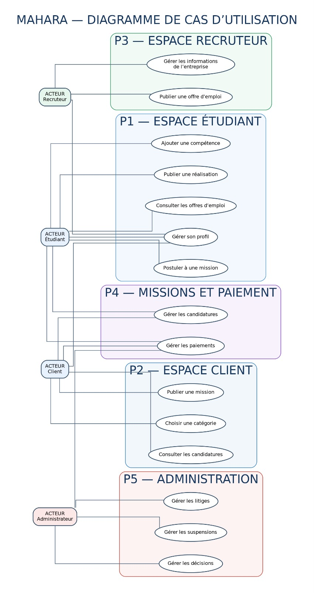
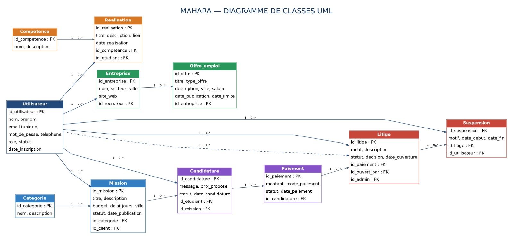

<p align="center">
  
</p>

# Mahara

**Ta mahara, ton avenir.**
Plateforme web de freelance pour les étudiants tunisiens, réalisée dans le cadre du module **Projet Technologies Web 2A** (Esprit, classe 2A15, année universitaire 2026-2027).

## Description

**Objectif.** Mahara met en relation trois publics : des **étudiants** qui proposent leurs compétences, des **clients** (commerces, particuliers, associations) qui publient des besoins, et des **recruteurs** qui cherchent des stagiaires ou de jeunes diplômés.

**Problème résolu.** Les plateformes de freelance existantes ne sont pas pensées pour les étudiants tunisiens : elles demandent souvent de l'expérience et des paiements en devises. Mahara propose des petites missions locales, payées en dinars (TND), pour gagner de l'expérience pendant les études.

**Principales fonctionnalités :**
- Inscription et connexion avec quatre rôles : étudiant, client, recruteur et administrateur
- Portfolio étudiant : compétences et réalisations
- Publication de missions par catégorie, avec budget, délai et ville
- Candidatures des étudiants aux missions et paiement sécurisé (bloqué puis libéré)
- Offres de stage et d'emploi publiées par les entreprises
- Back office : gestion des litiges et des suspensions de comptes

## Table des Matières
- [Modules et répartition](#modules-et-répartition)
- [Diagrammes](#diagrammes)
- [Base de données](#base-de-données)
- [Technologies](#technologies)
- [Installation](#installation)
- [Utilisation](#utilisation)
- [Contributions](#contributions)
- [Licence](#licence)

## Modules et répartition

La table **Utilisateur** est commune et réalisée par les 5 membres. Chaque membre est ensuite responsable d'un module de **deux entités liées par une jointure**.

| Module | Responsable | Entités | Jointure | Cas d'utilisation |
|---|---|---|---|---|
| Commun | Toute l'équipe | Utilisateur | – | S'inscrire, se connecter, gérer son profil |
| P1 · Espace étudiant | Membre 1 | Competence, Realisation | `realisation.id_competence` → `competence` | Ajouter une compétence, publier une réalisation, consulter les offres d'emploi, postuler à une mission |
| P2 · Espace client | Membre 2 | Categorie, Mission | `mission.id_categorie` → `categorie` | Publier une mission, choisir une catégorie, consulter les candidatures |
| P3 · Espace recruteur | Membre 3 | Entreprise, Offre_emploi | `offre_emploi.id_entreprise` → `entreprise` | Gérer les informations de l'entreprise, publier une offre d'emploi |
| P4 · Missions et paiement | Membre 4 | Candidature, Paiement | `paiement.id_candidature` → `candidature` | Gérer les candidatures, gérer les paiements |
| P5 · Administration | Membre 5 | Litige, Suspension | `suspension.id_litige` → `litige` | Gérer les litiges, les suspensions et les décisions |

## Diagrammes

### Diagramme de cas d'utilisation



### Diagramme de classes



## Base de données

Le script complet se trouve dans [`database/mahara.sql`](database/mahara.sql). Il contient :
1. la création de la base `mahara` et des 11 tables, avec leurs clés primaires et étrangères ;
2. des données d'exemple (fictives) pour tester ;
3. une requête avec jointure par module.

Exemple de jointure (module P2) :

```sql
SELECT m.titre, c.nom AS categorie, m.budget, m.ville
FROM mission m
JOIN categorie c ON m.id_categorie = c.id_categorie
WHERE m.statut = 'ouverte';
```

## Technologies

- **Front-end :** HTML, CSS, JavaScript
- **Back-end :** PHP
- **Base de données :** MySQL (via phpMyAdmin)
- **Serveur local :** XAMPP ou WAMP
- **Gestion de version :** Git et GitHub

## Installation

1. Clonez le repository :
   ```bash
   git clone https://github.com/azermensi6/Projet_Mahara_devs_2A15.git
   cd Projet_Mahara_devs_2A15
   ```

2. Si vous utilisez WAMP ou XAMPP :

* Placez le projet dans le dossier `www` (WAMP) ou `htdocs` (XAMPP).

* Démarrez Apache et MySQL depuis l'interface de WAMP/XAMPP.

* Ouvrez [http://localhost/phpmyadmin](http://localhost/phpmyadmin), cliquez sur **Importer** et choisissez le fichier `database/mahara.sql`.

* Accédez au projet via [http://localhost/Projet_Mahara_devs_2A15](http://localhost/Projet_Mahara_devs_2A15).

## Utilisation

### Installation de PHP

Pour utiliser ce projet, vous devez installer PHP. Voici les étapes :

1. Téléchargez PHP à partir du site officiel : [PHP - Téléchargement](https://www.php.net/downloads.php).

2. Installez PHP en suivant les instructions spécifiques à votre système d'exploitation :

   - Pour **Windows**, vous pouvez utiliser [XAMPP](https://www.apachefriends.org/fr/index.html) ou [WampServer](https://www.wampserver.com/).
   - Pour **macOS**, vous pouvez utiliser [Homebrew](https://brew.sh/), puis exécuter la commande suivante dans le terminal :
     ```bash
     brew install php
     ```
   - Pour **Linux**, vous pouvez installer PHP via le gestionnaire de paquets. Par exemple, sur Ubuntu :
     ```bash
     sudo apt update
     sudo apt install php
     ```

3. Vérifiez l'installation de PHP en exécutant la commande suivante dans votre terminal :
   ```bash
   php -v
   ```

### Comptes de test

Les comptes présents dans `database/mahara.sql` sont des exemples sans mot de passe utilisable. Pour vous connecter, créez un compte depuis la page d'inscription : le mot de passe est enregistré haché avec `password_hash()`.

## Contributions

Nous remercions tous ceux qui ont contribué à ce projet !

### Contributeurs

Les personnes suivantes ont contribué à ce projet :

- [Membre 1](https://github.com/utilisateur1) – Module P1 · Espace étudiant (Competence, Realisation)
- [Membre 2](https://github.com/utilisateur2) – Module P2 · Espace client (Categorie, Mission)
- [Membre 3](https://github.com/utilisateur3) – Module P3 · Espace recruteur (Entreprise, Offre_emploi)
- [Membre 4](https://github.com/utilisateur4) – Module P4 · Missions et paiement (Candidature, Paiement)
- [Membre 5](https://github.com/utilisateur5) – Module P5 · Administration (Litige, Suspension)

Si vous souhaitez contribuer, suivez les étapes ci-dessous pour faire un **fork**, créer une nouvelle branche et soumettre une **pull request**.

### Comment contribuer ?

1. **Fork le projet** : allez sur la page GitHub du projet et cliquez sur le bouton **Fork** dans le coin supérieur droit pour créer une copie du projet dans votre propre compte GitHub.

2. **Clonez votre fork** : clonez le fork sur votre machine locale :
   ```bash
   git clone https://github.com/votre-utilisateur/Projet_Mahara_devs_2A15.git
   cd Projet_Mahara_devs_2A15
   ```

3. **Créez une branche** pour votre module ou votre correction :
   ```bash
   git checkout -b module-p1-espace-etudiant
   ```

4. **Validez et envoyez vos modifications** :
   ```bash
   git add .
   git commit -m "Ajout du CRUD des compétences"
   git push origin module-p1-espace-etudiant
   ```

5. **Ouvrez une pull request** vers la branche `main` du projet.

## Licence

Ce projet est sous la licence **MIT**. Pour plus de détails, consultez le fichier [LICENSE](./LICENSE).

### Détails sur la licence MIT

La licence MIT est une licence de logiciel libre et permissive : elle autorise l'utilisation, la copie, la modification et la redistribution du code, à condition de conserver la mention du copyright et le texte de la licence.
